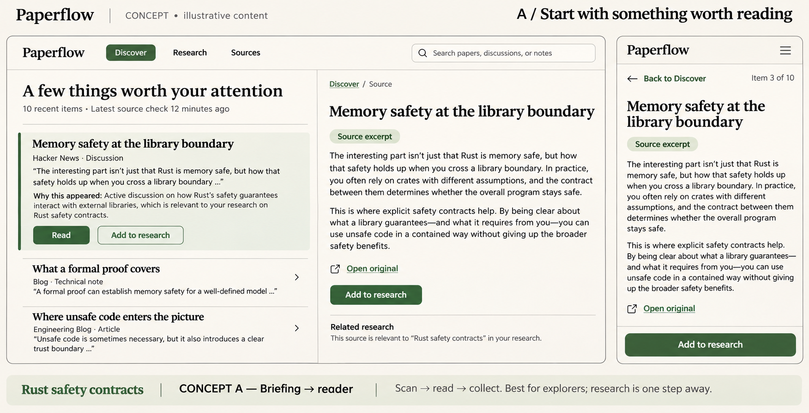
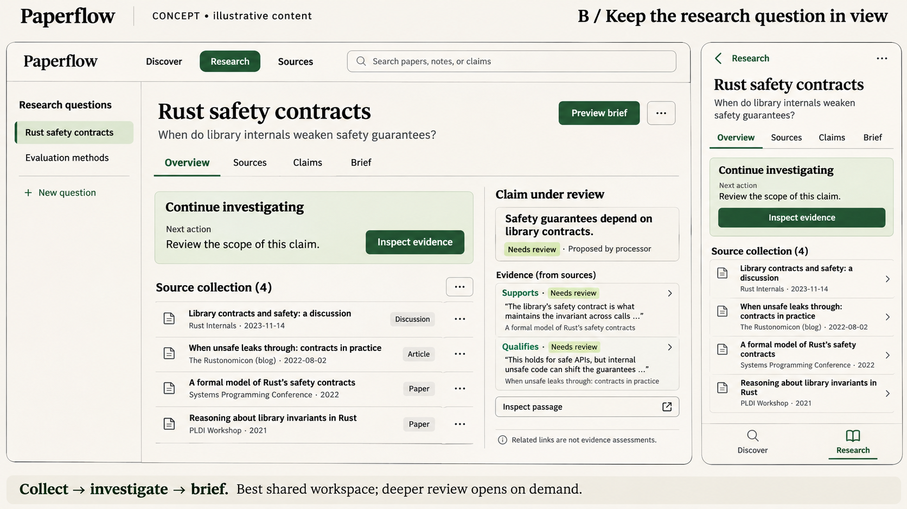

# Paperflow reader concepts, v1

Generated with the built-in imagegen tool on 2026-11-15. Static composition
studies using illustrative content; not working screens or an accessibility
certification. The [core design document](../core-reader.md) contains
journey priorities, the accessibility contract, implementation gaps, and tasks
for testing. **D is the user-selected primary direction.** B is the recommended
research workspace, not the default entry. These are complementary modes of one
product rather than four separate applications.

## D — Everyday reader (selected)

Task: browse → read → discuss → return. Reading settings expose type size, line
spacing, width, font family and contrast. Save for later does not require a
research bucket. Add to research is available when needed. The next implemented
prototype should test this flow first, including focus/scroll restoration.

[Exact generation prompt](everyday-reader-prompt.txt).

## A — Briefing to reader

Task: scan a finite briefing → preview → read → collect. Test whether a desktop
preview saves navigation effort without reducing reading width. Mobile should
remain a dedicated reader. After the reading-first clarification, label the
entry Today and retain independent Saved state from concept D.

Generation brief: an editorial finite discovery list and adjacent source preview,
with clear source-excerpt labels, original-source links, Add to research, a
preserved item index, and a separate mobile reading screen.

## B — Research workspace

Task: collect → investigate → brief. This is the deeper Research destination.
Source collection should remain lightweight; assessment controls appear after
Inspect evidence. The mobile version navigates to a separate evidence screen.

Generation brief: keep the research question visible, show a compact collection,
one next investigation action, and evidence statuses in a contextual desktop
rail. Preserve the same hierarchy on mobile without squeezing in the rail.

## C — Claim investigation

Task: claim → passage → interpretation → review. This is a focused secondary
screen. Accepting an assessment means accepting an interpretation of a source
passage, not declaring a universal claim true. Source links and review history
stay available.

Generation brief: make the distinction between quoted source, assessment
rationale, stance and review decision unmistakable. Show processor proposals as
Needs review, with a dedicated subsequent review step on mobile.

## Shared generation direction

High-fidelity, flat desktop/mobile comparison boards; warm ivory, dark ink and
forest-green accent; editorial typography; restrained borders and generous
whitespace. Use the same illustrative Rust-safety subject to compare information
architecture rather than visual themes. No marketing artwork, truth scores,
or popularity-as-evidence presentation. These are built-in imagegen outputs,
not CLI/API image generation.

## Changes to carry into implementation

- Use consistent Today / Saved / Research global navigation across all screens;
  secondary menus drawn in A–C are exploratory, not additional required tabs.
- Read source opens the local reader; only Open original uses an external-link
  indicator. The image generator used an external icon inconsistently in D.
- Counts, votes, source names and passages are illustrative. Render votes only
  when a source actually supplies them; unknown is not zero. Current HN comments
  are sampled, and Reddit access is not yet approved.
- Numeric typography controls need accessible names and values, not just the
  symbolic line-spacing/width icons in the mock. Settings are keyboard-operable,
  dismissible, and must preserve or restore focus. Mobile uses a dedicated sheet.
- Readability, contrast, focus order, zoom, screen-reader announcements, forced
  colors, touch targets and saved reading state need testing in semantic HTML.
  Images cannot validate these properties. Essential product text is never
  shipped as image text.
- Keep explicit reading preferences independent of decorative theme selection.
  Reader-state persistence, full article extraction and fuller discussion
  ingestion are backend work, not capabilities established by these mocks.

Delivery sequencing: [Reader release plan](../../plans/reader-release.md). The MVP
runs without identity; browser identity integration follows the running MVP.
